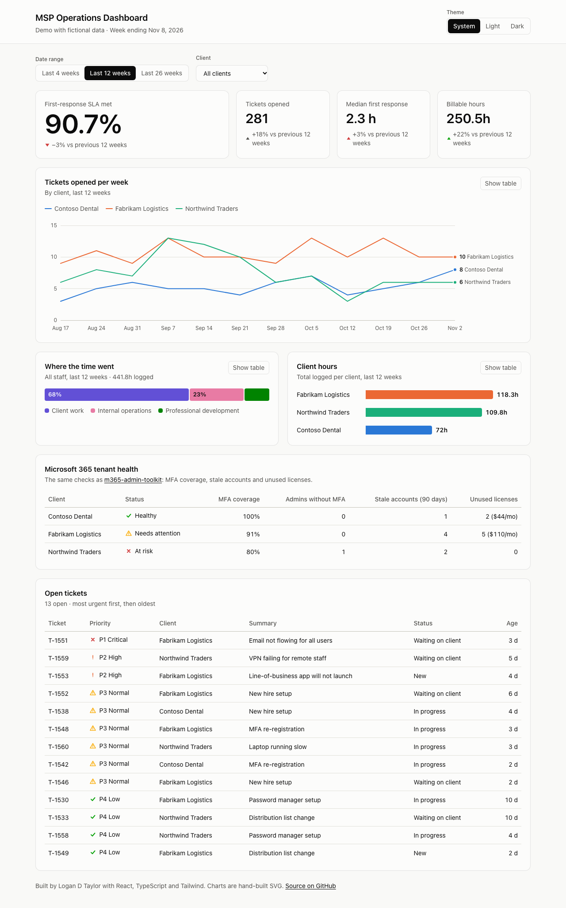
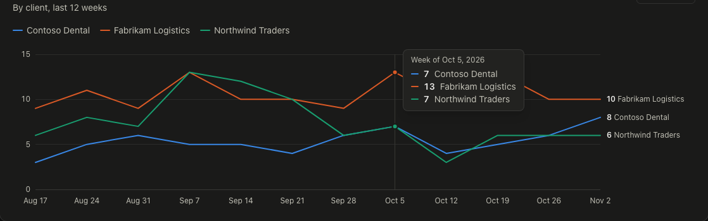
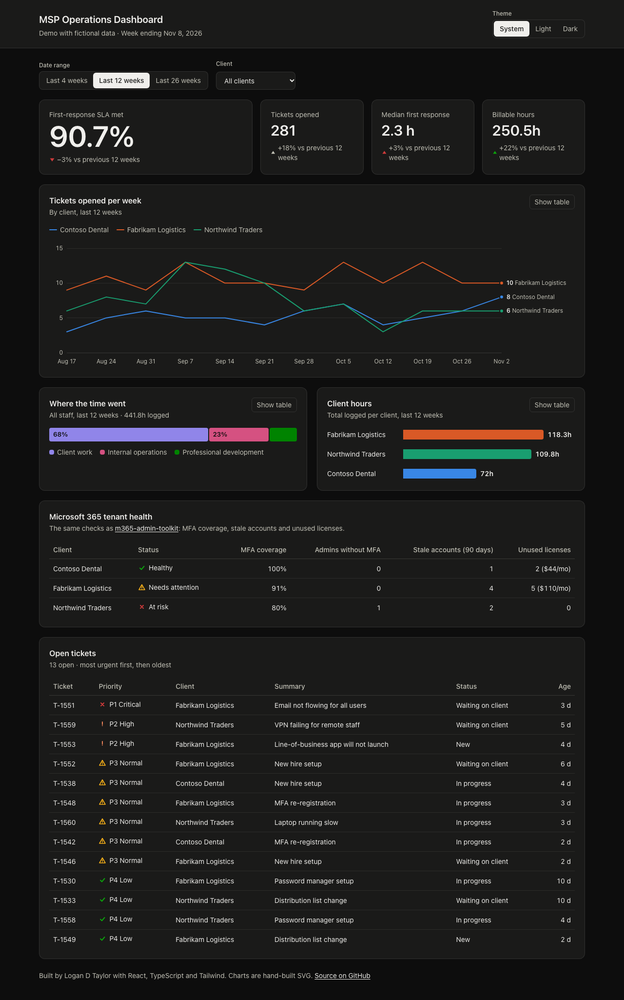
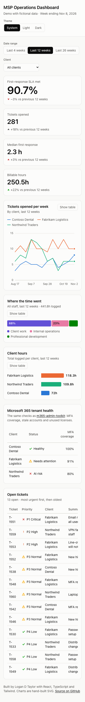

# MSP Operations Dashboard

[](https://github.com/LoganTaylorITGuy/msp-ops-dashboard/actions/workflows/ci.yml)


**[▶ Live demo](https://logantayloritguy.github.io/msp-ops-dashboard/)**

The weekly view I wanted as a technical services manager at a managed services provider:
service levels, ticket volume, where the team's time went, and which client tenants need
attention, all on one page. It runs on fictional data.



<details>
<summary>Dark mode, tooltip and phone layout</summary>






</details>

## What's on it

| Section | Answers |
|---|---|
| **SLA hero figure + stat tiles** | Are we responding on time? Is volume, response time or billable work trending the wrong way vs the previous period? |
| **Tickets per week** | Which client is driving the workload, and when? (Note the Northwind spike during their firewall project.) |
| **Where the time went** | Client work vs internal operations vs professional development, the same three buckets as [sharepoint-report-publisher](https://github.com/LoganTaylorITGuy/sharepoint-report-publisher) |
| **Client hours** | Ranked hours per client, with the billable split on hover |
| **M365 tenant health** | MFA coverage, unprotected admins, stale accounts and wasted licenses, the same checks as [m365-admin-toolkit](https://github.com/LoganTaylorITGuy/m365-admin-toolkit) |
| **Open tickets** | Everything unresolved, most urgent first, then oldest |

The date-range and client filters apply to every number on the page, so the figures
always agree with each other.

## Engineering decisions

**Charts are hand-built SVG, no chart library.** That gave full control over the details
that make a chart readable: 2px lines, a crosshair that snaps to the nearest week, end
labels that only appear when they won't collide, bars that grow from a shared baseline, and
a segmented bar that only prints a share inside a segment when it fits.

**Accessibility built in from the start, not bolted on (WCAG 2.1 AA):**
- Every chart has a **"Show table"** view, and every bar and segment has an accessible name
  with its value.
- The line chart is **keyboard-navigable**: focus it and use ← / → / Home / End, with each
  week read out through a polite live region.
- **Status is never color alone.** Every health and priority state has an icon and a text label.
- **Colorblind-safe palette, checked with a script** (deuteranopia, protanopia, tritanopia)
  in both themes. Dark mode uses its own validated color steps rather than an automatic
  inversion. Text inside a colored segment switches between white and black based on
  measured contrast.
- Skip link, real `<table>` markup with captions and scoped headers, labelled filter
  controls, and keyboard-scrollable wide tables on phones.

**Data logic kept apart from the UI.** Every number comes from pure functions in
[`src/data/selectors.ts`](src/data/selectors.ts), unit-tested separately from React. The
fictional data comes from a seeded generator with a fixed "as of" date, so the demo and the
tests are deterministic.

**Theme handling.** The page follows the OS theme until the viewer picks one. The choice is
saved in `localStorage`, wrapped in try/catch so a private window still works.

## Quality gates (all run in CI)

| Check | Tool |
|---|---|
| Lint | oxlint |
| Types | TypeScript `strict` |
| Unit and component tests | Vitest + Testing Library: 30 tests, ~93% line coverage |
| Accessibility in the test DOM | axe-core, light and dark, with every table view open |
| **Accessibility in a real browser** | Playwright + axe-core, *including color contrast*, light/dark × desktop/phone, plus a check for sideways page scroll |
| Deploy | GitHub Pages, only after every check passes |

## Run it

```bash
npm install
npm run dev          # http://localhost:5173
npm test             # unit + component tests
npm run build && node scripts/browser-check.mjs   # real-browser a11y check + screenshots
```

## Stack

React 19 · TypeScript · Vite · Tailwind CSS 4 · Vitest · Testing Library · axe-core · Playwright

## License

MIT © Logan D Taylor
